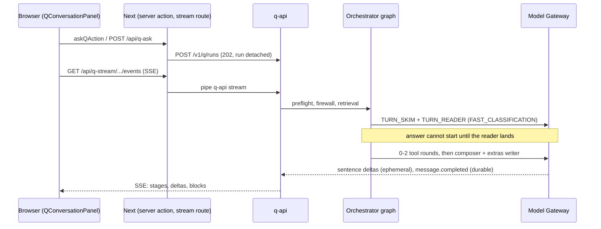
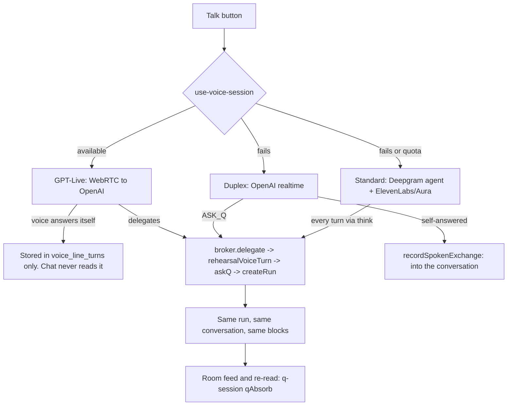

# Capital Q: live-demo multimodal audit, 4 November 2026

**How to read the evidence.** Each claim carries one of three labels.

- **OBSERVED:** seen on production on 2026-11-04 in a scripted real browser or in production logs.
- **CODE:** read in source at the cited lines. Not observed running.
- **REC:** a figure already recorded in the repo. Often a small sample, and possibly stale.

Code citations are `path:line` at SHA `d25c0843c`. Short forms: `q/` = `apps/web/src/features/q/`, `voice/` = `apps/web/src/features/voice/`, `mg/` = `packages/model-gateway/src/q/`.

## 1. Repository and deployed-baseline identity

| Item                           | Value                                                                                                            |
| ------------------------------ | ---------------------------------------------------------------------------------------------------------------- |
| Repository                     | `neo1415/q`                                                                                                      |
| Branch and worktree examined   | `fix/resume-asking`, main checkout; clean at audit start                                                         |
| Full HEAD SHA                  | `d25c0843c5f3114ceba87895c43252e00f8f9659`                                                                       |
| Other worktree, left untouched | `q-integrate` on `speed/q-oct20` (local `b77f8d775`, remote `8136d919b`). Historical; not used as an authority   |
| Stale local branch             | Local `build/int-rc` is `1cb6c83f0` (20 Oct). Remote `build/int-rc` is `d25c0843c`. The local ref is not current |
| Production: web                | `d25c0843c`, SUCCESS, 2026-11-04 09:49 UTC                                                                       |
| Production: q-api              | `c53a08055`, SUCCESS, 2026-11-02 20:41 UTC                                                                       |
| Production: api, workers       | `b10cd6c87`, SUCCESS, 2026-11-01 17:19 UTC                                                                       |
| Deploy and CI branches         | `recovery/2026-09-12` and `recovery/2026-09-12-8y2j4w`, both `d25c0843c`                                         |
| CI on `d25c0843c`              | Green: build, format/lint, typecheck, test, pgTAP, quality. e2e skipped (manual)                                 |
| Migrations                     | 268/268 per `STATE.md`; not re-queried, no Supabase token here                                                   |

**Deployment during this audit.** Just before this audit the owner explicitly asked for a separate fix to be deployed (Q page opens clean; Q / Chat switch always shown). It was already in CI when the audit began, and it deployed before the rehearsal, so the rehearsal ran against it. The audit itself deployed nothing.

**Production settings (read-only).**

- q-api: `DATABASE_POOL_MAX=3`, pooler on port 5432, database in `eu-central-1`.
- `CQ_VOICE_LIVE` on, `CQ_VOICE_LIVE_USERS=*`, `CQ_VOICE_LIVE_DAILY_CAP_USD=20`.
- `CQ_VOICE_REALTIME` on, cap 20.
- `Q_VOICE_PROVIDER` unset, so Deepgram is the standard transport.
- `CQ_Q_PITCH_TOUR=1` on web, unset on q-api.
- Replica count and region did not return from the Railway query. `STATE.md:747` recorded a single replica once.

**Scope caveats.**

- Voice was not exercised. It needs a microphone and paid minutes, and the directive forbids that without authorization.
- Docs read in full: `CLAUDE.md`, `START-HERE.md`, `HANDOFF-2026-11-01.md`, the relevant `DECISIONS` items, `ACTIVE-TASKS.md` (top).
- Skimmed by heading or in part only: `Q_PITCH_MASTER_BLUEPRINT.md`, `IMPLEMENTATION_STATUS.md`, `CERTIFICATION_MANIFEST.md`, docs 17 and 18.
- **Not read:** docs 11, 12, 14, 15, 22 and 24 and the locked PADL. They exist; the audit relied on `CLAUDE.md`'s statement of their binding rules.

## 2. Executive diagnosis

**What works (OBSERVED on production).**

- Typed Q gives real ranked cards with identities, scores and a breakdown, in Chat, the Q view and at phone width.
- Follow-up "compare the first two" gives a real side-by-side table.
- Public-source research runs, with sources listed. Live memo job `12e184e4`, 2 Nov: 38 sources, $0.053.
- A drafted introduction becomes a real approval card with Approve, Change it, Keep it with me and Drop. It survives a page refresh.
- "What am I looking at?" on a company page names the company and tab.
- GPT-Live lines do open (3 lines in the current log window).
- No page errors in any scenario.

**What demonstrably fails (OBSERVED).**

1. **Words typed in the first ~3.5 s after the composer appears are silently destroyed.** In 4 of 4 human-speed tries, Q was sent only a fragment ("mandate.", "e.", "date.", "ndate."). With instant entry, 7 of 8 tries below 4 s sent nothing and showed nothing. The box looks ready and isn't.
2. **"Compare the second and third" compared the first two** (MedTrail and Duplo) and stated the result as the answer.
3. **"Open Ledgerline's company profile and show the financials"** moved to the profile and stored only "Opening Ledgerline…". The financials half was dropped with no mention.
4. **Q said Ledgerline's profile "gives no… burn rate"**, while that profile's Key numbers show "Current monthly net burn: About $39,000".
5. **Every typed answer is sent to paid speech synthesis by default:** 16 `/api/q-speech` calls across 5 typed turns in one conversation. The owner has already heard this as Q's voice changing.

**Highest-impact user-visible gap.** The first-question failure (item 1) is the demo risk: it can happen in the first ten seconds, in front of a client, with nothing on screen to explain it. The largest gap against the "one continuous experience" goal is structural and sits in voice (Section 3): on GPT-Live, whatever the voice answers itself is never stored in the conversation.

**Honest overall position.** One brain and one conversation already exist for typing and for delegated voice turns. The product is closer to the goal than it feels. The feel is damaged by a small number of seam defects and by a 2–4 s fixed routing cost before Q starts any answer. Charts and in-conversation video are the two genuinely missing output surfaces.

## 3. System flow map

### Typed turn

| Step                    | Citation (CODE)                                                                                                                                                         |
| ----------------------- | ----------------------------------------------------------------------------------------------------------------------------------------------------------------------- |
| Composer and intercepts | `packages/ui/src/patterns/q-composer.tsx:140,300`; `q/q-conversation.tsx:810-832`; `q/use-q-conversation.ts:503-546`                                                    |
| Start                   | `q/ask-route.ts:16-55`; `apps/q-api/src/http/q-runs.ts:111-163`                                                                                                         |
| Stream                  | `apps/web/app/api/q-stream/v1/q/runs/[runId]/events/route.ts:43-101`; `apps/q-api/src/http/q-events.ts:197-462`; `packages/q-runtime/src/application/stream.ts:383-594` |
| Graph                   | `packages/q-orchestrator/src/graph.ts:567-574`                                                                                                                          |
| Answer                  | `packages/q-specialists/src/answer.ts:1943,5646`; `mg/index.ts:2554,8581-8605`                                                                                          |
| Tools                   | `packages/q-tools/src/executor.ts:237-468`; `authorize` required by type at `packages/q-tools/src/definition.ts:154`                                                    |
| Result contract         | `packages/contracts/src/q/result-block.ts:718-752`; per-block drop at `:776-815`                                                                                        |
| Render                  | `q/q-answer.tsx:141-358`; `q/q-result-blocks.tsx:403-678`; `q/q-presence-stage.tsx:136-711`                                                                             |

### Voice, and where it diverges

- Selection: `voice/use-voice-session.ts:129-166`.
- **Divergence 1, the largest:** the no-op transcript mirror on live at `apps/q-api/src/main.ts:7748-7752`, against the real mirror on duplex at `:7648-7657`. The prompt orders self-answering for small talk, general knowledge and rephrasing at `apps/q-api/src/voice/live/prompt.ts:112-119`.
- **Divergence 2:** GPT-Live opens with no thread context and an unconditional greeting (`voice/provider/live-session.ts:64-65,159-164`; `apps/q-api/src/voice/live/context.ts:68-173`).
- **Divergence 3:** `noteToLine` has no subscriber on GPT-Live (`voice/line-cards.ts:117-124`; subscribers only in `voice/provider/duplex-session.ts:240` and `voice/provider/standard-cards.ts:70`). Card taps and failed moves go unsaid. `decide_card` doesn't exist on it.
- **Divergence 4:** typing behaves differently by surface. The Q page composer closes the call (`q/q-conversation.tsx:826-830`). The dock sheet keeps it (`q/q-sheet.tsx:299-306`). Cards and suggestions keep it (`q/q-conversation.tsx:780-786`).

### Durability, screen context, actions, approvals

- **Durable vs ephemeral:** `q.message.delta` and `q.artifact.preview` are ephemeral (`packages/contracts/src/q/stream.ts:79-82`); the rest replay by sequence. A finished answer survives refresh (OBSERVED). A mid-answer refresh loses words so far and resumes as a fragment (CODE: `q/use-q-conversation.ts:435-451`; `packages/api-client/src/q-stream-reducer.ts:139-153`). The delta bus is in-process (`apps/q-api/src/main.ts:1152`), so more than one q-api replica would lose live text.
- **Screen context:** ids and closed kinds only, never page text (`q/screen.ts:244-291`; `q/manifest.ts:48-54,402-464`). Details in Section 6.
- **Approvals:** one engine for voice and typed (`apps/q-api/src/composition/conversation-approvals.ts:249-584`). Details in Section 6.

## 4. Feature and modality parity matrix

Status values follow the directive. "Local" means tests only. Nothing was mocked in the OBSERVED rows. **No scripted demo flow was used as evidence.** Separately, scripted voice exists only under dev routes (`apps/web/app/dev/q-nav/`), gated by `layout.tsx:33-36`. `apps/web/app/dev/q-story/` and `dev/story/` show no gate in their own files, and a shared gate was not confirmed.

### Input modes

| Mode                                  | Status                                        | Proof and gap                                                                                                                                                                           |
| ------------------------------------- | --------------------------------------------- | --------------------------------------------------------------------------------------------------------------------------------------------------------------------------------------- |
| Typed to typed                        | **PARTIAL**                                   | OBSERVED working after load; first ~3.5 s destroys input (defect D1)                                                                                                                    |
| Voice to text (dictation)             | **NOT_IMPLEMENTED**                           | CODE: the only mic control is Talk (`q/q-conversation.tsx:1863`); no dictation path                                                                                                     |
| Typed to spoken                       | **VERIFIED_END_TO_END**                       | OBSERVED: 16 `/api/q-speech` calls in 5 turns. Audio not heard by the audit. It's on by default (D5)                                                                                    |
| Live voice to live voice              | **BLOCKED_BY_PROVIDER/ACCESS** for this audit | Logs OBSERVED: lines open, one delegation answered in 8,555 ms, not aborted. Not run by the audit                                                                                       |
| Speech while a canvas or card is open | **CODE_EXISTS_UNVERIFIED**                    | Q Brain sees the open document via a 1.5 s screen poll (`voice/use-voice-interview.ts:801-819`). GPT-Live itself tracks path and title only (`voice/live/live-call.ts:280-292,717-732`) |
| Switching speak and type              | **PARTIAL**                                   | Conversation id survives. Self-answered turns, voice context and a run in flight don't (Section 3)                                                                                      |
| Interruption, reconnect, resume       | **CODE_EXISTS_UNVERIFIED**                    | CODE: renew max 2, one reconnect, new session re-greets. After a q-api restart, delegations 404 while the call stays up (`voice/live/live-call.ts:229,347,976-1003`)                    |

### Output surfaces

| Surface                         | Status                                                 | Proof and gap                                                                                                                                                                                                           |
| ------------------------------- | ------------------------------------------------------ | ----------------------------------------------------------------------------------------------------------------------------------------------------------------------------------------------------------------------- |
| Markdown                        | **VERIFIED_END_TO_END**                                | OBSERVED. No inline citations: sources sit behind a chip (`q/q-answer.tsx:321-335`)                                                                                                                                     |
| Source references               | **VERIFIED_END_TO_END**                                | OBSERVED: `PUBLIC_SOURCE` blocks stored and a Sources chip shown on the follow-up. Answer-level only                                                                                                                    |
| Company/investor cards          | **VERIFIED_END_TO_END**                                | OBSERVED. `COMPANY_REFERENCE` cards are unnamed (`q/q-result-blocks.tsx:452-454`)                                                                                                                                       |
| Ranked recommendations          | **VERIFIED_END_TO_END**                                | OBSERVED at 1440 and 390, Chat and Q views                                                                                                                                                                              |
| Side-by-side comparison         | **PARTIAL**                                            | First two: OBSERVED. Second and third: wrong pair (D2). A cell read "Not known: Post-money SAFE, $10m cap in their deck", which contradicts itself                                                                      |
| Tables                          | **VERIFIED_END_TO_END**                                | OBSERVED (`TABLE` stored and drawn)                                                                                                                                                                                     |
| Charts                          | **NOT_IMPLEMENTED** in conversation                    | CODE: `chartBlock` has no production caller (verified by grep; test callers only). `mg/result-blocks.ts:1044-1046` returns null for CHART. Renderer exists and is unreachable                                           |
| Maps, timelines                 | **CODE_EXISTS_UNVERIFIED**                             | CODE: maps are country level; timeline only for one relationship read (`mg/result-blocks.ts:1014-1043`)                                                                                                                 |
| Images with attribution         | **CODE_EXISTS_UNVERIFIED**                             | CODE: `q/blocks/picture-block.tsx`; host rules at `result-block.ts:547-602`. Company photo requests OBSERVED                                                                                                            |
| Seeded pitch video              | **PARTIAL**                                            | Discover player shows the pitch with a loading spinner (OBSERVED). `readyState` stayed 0 after 6 s in headless Chromium, which may lack the codec: **inconclusive**. All 3 video elements report `preload="auto"` (D13) |
| Video in conversation           | **NOT_IMPLEMENTED**                                    | CODE: no `<video>` under `q/` (verified by grep). "Watch the pitch" navigates away (`q/client-actions.ts:128-129`)                                                                                                      |
| Document/PDF viewer             | **CODE_EXISTS_UNVERIFIED**                             | CODE: `q/material-viewer.tsx:123`, `q/room/q-room-document.tsx:313-350`. Not opened by the rehearsal                                                                                                                    |
| Generated report with revisions | **VERIFIED_END_TO_END** (filing), revisions unverified | OBSERVED 2 Nov: memo job `12e184e4` filed and read back. Version UI is CODE (`q/artifact-viewer.tsx:226,382,409`)                                                                                                       |
| Decks, spreadsheets, downloads  | **CODE_EXISTS_UNVERIFIED**                             | CODE: `q/artifact-download.tsx:60-69`; `packages/contracts/src/q/artifact.ts:954-981`. Handoff records earlier live checks; not re-run                                                                                  |
| Plan, progress, agent status    | **CODE_EXISTS_UNVERIFIED** this audit                  | OBSERVED live 2 Nov: job steps and "Read 38 public sources". Plan card not re-run (cost). PLAN and ATTENTION are absent from the Q stage (CODE, D8)                                                                     |
| Draft preview                   | **VERIFIED_END_TO_END**                                | OBSERVED. Editors exist only for `email.send` and `chat.message.send` (CODE). This draft was an interest note                                                                                                           |
| Actionable approval             | **VERIFIED_END_TO_END** up to the card                 | OBSERVED. **Approve deliberately not clicked**                                                                                                                                                                          |
| Errors, empty, offline          | **PARTIAL**                                            | Empty OBSERVED. CODE: `GAVE_UP` shows no notice and leaves the composer on a dead run (`q/use-q-conversation.ts:342-351,567-575`)                                                                                       |
| Mobile canvas and sheets        | **PARTIAL**                                            | OBSERVED at 390: ranked cards fine, no sideways overflow. Canvas and viewer sheets not exercised                                                                                                                        |

### Context and actions

| Capability                                 | Status                                     | Proof and gap                                                                                                                                                                      |
| ------------------------------------------ | ------------------------------------------ | ---------------------------------------------------------------------------------------------------------------------------------------------------------------------------------- |
| "What am I looking at?"                    | **VERIFIED_END_TO_END**                    | OBSERVED via the dock: named Ledgerline, the Overview tab, and the other tabs                                                                                                      |
| Server re-authorises the screen's entity   | **CODE_EXISTS_UNVERIFIED**                 | CODE, solid: `packages/q-runtime/src/application/create-run.ts:545-584`; `packages/q-firewall/src/firewall.ts:178-238`. Denial not tested live                                     |
| Navigation by words                        | **VERIFIED_END_TO_END**                    | OBSERVED: moved to the profile                                                                                                                                                     |
| Move plus show                             | **BROKEN**                                 | OBSERVED: second clause dropped silently (D3)                                                                                                                                      |
| "Compare the second one"                   | **BROKEN**                                 | OBSERVED (D2); cause at `packages/q-specialists/src/conversation-entities.ts:109-110,126`                                                                                          |
| Dismiss, reopen                            | **PARTIAL**                                | OBSERVED: X removes the card; no "Show again" appears; refresh brings it back. Stage and chat use different keys (CODE, `q/answer-canvas.tsx:939-941`; `q/stage-canvas.tsx:68-79`) |
| Draft, edit, approve, execute, receipts    | **CODE_EXISTS_UNVERIFIED** beyond the card | CODE, solid (Section 6). Execution not run, by rule                                                                                                                                |
| Private founder/investor boundary          | **PARTIAL**                                | No leak seen. Q declined payroll and runway. But its stated reason was wrong against the page (D4)                                                                                 |
| Conversation and artifacts survive refresh | **VERIFIED_END_TO_END**                    | OBSERVED: 7 answers and the card returned after reload                                                                                                                             |
| Rate and cost protections                  | **PARTIAL**                                | CODE: the live cap is platform-wide with no per-person limit (`apps/q-api/src/voice/live/spend.ts:20-25`). Mid-call cap is client-enforced, with a server sweep as backstop        |

## 5. Artifact renderer registry

`Q_RESULT_BLOCK_KINDS` lists 23 kinds (`packages/contracts/src/q/result-block.ts:48-78`). The union has 24 (`:718-743`): `WORK_IN_PROGRESS` is missing from the list.

Columns: **Chat** = `QAnswer cardsInline`. **Stage** = `SHOWABLE` (`q/shown.ts:36-52`). **Caption** = `QAnswer picturesInline={false}` inside the stage, default on. **Dock** = `q/q-sheet.tsx:243-248`, latest Q turn only.

| Kind                  | Producer                                                                          | Chat                      | Stage         | Caption       | Dock   | Flag                                                    |
| --------------------- | --------------------------------------------------------------------------------- | ------------------------- | ------------- | ------------- | ------ | ------------------------------------------------------- |
| TEXT                  | None as a block                                                                   | prose                     | caption       | prose         | prose  | Declared, never produced                                |
| COMPANY_REFERENCE     | `mg/result-blocks.ts:190`                                                         | chip                      | no            | chip          | chip   | Card has no name                                        |
| INVESTOR_REFERENCE    | `mg/result-blocks.ts:194`                                                         | chip                      | no            | chip          | chip   |                                                         |
| COMPARISON            | None                                                                              | table                     | yes           | yes           | yes    | **Rendered, never produced**                            |
| COMPARISON_CARDS      | `mg/result-blocks.ts:498`                                                         | inline                    | yes           | **duplicate** | yes    |                                                         |
| ANSWER_CARDS          | `mg/answer-cards.ts:125`, `fit-cards.ts:423`, `discover-companies.ts:260`, others | inline                    | `StageCanvas` | excluded      | inline | Two controllers (D7)                                    |
| EVIDENCE              | None                                                                              | count                     | no            | count         | count  | **Declared, never produced**                            |
| FINDING               | `mg/result-blocks.ts:442`                                                         | Sources chip              | no            | chip          | chip   |                                                         |
| UNCERTAINTY           | `mg/result-blocks.ts:525,534`                                                     | Sources chip              | no            | chip          | chip   |                                                         |
| CLARIFICATION_REQUEST | `mg/result-blocks.ts:548`                                                         | inline                    | yes           | **duplicate** | yes    |                                                         |
| ACTION_PROPOSAL       | `packages/q-actions/src/application/narrator.ts:159`                              | QNow                      | no            | QNow          | QNow   | Case in `q/q-result-blocks.tsx:567-582` unreachable     |
| ARTIFACT_REFERENCE    | `mg/index.ts:6646,10570`; `workforce/delivery.ts:335,427`                         | inline                    | yes           | excluded      | inline |                                                         |
| UI_INTENT             | Many                                                                              | inline; null with no href | room handled  | inline        | inline | SHOW_COMPARISON, SHOW_EVIDENCE routes null (`:108-111`) |
| PUBLIC_SOURCE         | `mg/index.ts:6822`                                                                | chip                      | no            | chip          | chip   | Answer-level only                                       |
| TABLE                 | `mg/result-blocks.ts:656,776`; `mg/compare-table.ts:399`                          | inline                    | yes           | **duplicate** | yes    |                                                         |
| CHART                 | Uncalled `chartBlock`                                                             | case exists               | yes           | yes           | yes    | **Rendered, never produced**                            |
| MAP                   | `mg/result-blocks.ts:598,626`; `mg/companies-map.ts:235`                          | inline                    | yes           | **duplicate** | yes    |                                                         |
| TIMELINE              | `mg/result-blocks.ts:802`                                                         | inline                    | yes           | **duplicate** | yes    | Narrow trigger                                          |
| ATTENTION             | `mg/index.ts:6991`                                                                | inline                    | **no**        | inline        | inline |                                                         |
| SUMMARY               | `mg/result-blocks.ts:706`                                                         | inline                    | yes           | **duplicate** | yes    | Not in `DRAWN_BLOCK_KINDS`                              |
| PICTURE               | `mg/result-blocks.ts:1112`; `mg/index.ts:7224,7256`                               | inline                    | yes           | excluded      | inline |                                                         |
| WORK_IN_PROGRESS      | `workforce/delivery.ts:341,370,440`; `team-job.ts:482`                            | inline                    | **no**        | inline        | inline | Missing from kinds list                                 |
| SCHEDULE              | `mg/result-blocks.ts:962`; `mg/index.ts:6689`                                     | inline                    | **no**        | inline        | inline | D8                                                      |
| PLAN                  | `workforce/plan-job.ts:3129`; `answer.ts:7365`                                    | inline                    | **no**        | inline        | inline | D8                                                      |

The "duplicate" and "no" columns are derived from conditional logic (CODE), not observed. The rehearsal's ranked answer showed no duplication, as expected for ANSWER_CARDS.

**"They're on screen."** The text is appended unconditionally with cards (`mg/discover-companies.ts:554,586`). As of `d25c0843c` the chat view draws them, so the claim is now backed in Chat (OBSERVED), Q view (OBSERVED) and dock (CODE, unless a later message follows).

**The rule lives in three unshared lists** (`q/q-answer.tsx:34-94`, `q/shown.ts:36-52`, `mg/screen-claims.ts:80-90`). A "show my schedule" answer can get its sentence rewritten to "I haven't been able to open that on your screen" beside the visible card (CODE: `mg/index.ts:10495-10504`).

## 6. Current-screen and action authority audit

**What Q can see.** Route (closed list), company, investor organisation, document or artifact id and page, attached document ids (max 5), time zone, and a manifest of ids, tabs, filters, visible sections, controls and notices. **Never page text, field values or screenshots** (`q/manifest.ts:48-54`). `data-q-hidden` regions are excluded (`:186-188,226`).

**Is the client's claim trusted?** No, for reads. Named entities are resolved or dropped (`create-run.ts:545-584`), filtered again by the firewall, and manifest refs are read back through `tools.execute` under the plan (`mg/index.ts:3662-3693`). Trusted without re-read: `controls`, `notices`, `inView`, `filters`. These only let a tampered client misdescribe its own screen.

**What Q can control.** `operate_screen` (19 acts, `packages/contracts/src/q/ui-act.ts:79-110`), `open_page`, `control_screen`, `control_document`, filters, theme, reload, sign-out, voice. No selectors, coordinates or scripts. `ACTIVATE` clicks a registered button (`q/control/perform.ts:199-214`), and consequence is limited by what's registered, not by enforcement: not every `useQControl` was audited.

**Receipts.** Real browser-side verification for `UI_ACT` (`q/control/perform.ts:23-33,188-289`). `control_screen` has **no receipt** (`q/client-actions.ts:552-593,744-750`). The ledger is in-process with a 10-minute TTL (`apps/q-api/src/http/ui-act-receipts.ts:32-39`).

**Approvals holding up (CODE).** All verified present in the trace:

- SHA-256 payload binding (`packages/q-actions/src/domain/binding.ts:29-46`), recomputed at approve and execute (`service.ts:1521-1535,1899-1915`).
- Edit means re-approval (`service.ts:2169-2272`).
- Execute re-authorises the actor (`:1885-1896`).
- Duplicate claim by row lock (`:1925-1970`); unknown outcome never retries (`:1999-2013`).
- 24-hour expiry enforced.

**Firewall entry points (CODE).** Typed, spoken, live, duplex, hand-over and fast navigation all plan. Differences to review:

- Workforce model calls carry no plan and hard-code `CONFIDENTIAL` (`workforce/models.ts:470-492`); inputs come from plan-bound reads.
- Standing instructions have no firewall plan (`composition/instructions/engine.ts`; direct gateway at `instructions/planner.ts:94-121`).
- **No leak was shown on either path.**
- No `run_sql` or generic fetch tool found.
- `discover_companies` returns six declared fields (`packages/q-tools/src/tools/discover-companies.ts:393-400`).

**Security and integrity defects (verified in code; severity is the auditor's judgement).**

| #   | Finding                                                                                                                                                                                                                                                          | Evidence                                                                                                                                                                                      | Severity                                                                          |
| --- | ---------------------------------------------------------------------------------------------------------------------------------------------------------------------------------------------------------------------------------------------------------------- | --------------------------------------------------------------------------------------------------------------------------------------------------------------------------------------------- | --------------------------------------------------------------------------------- |
| S1  | Q artifact reads filter only on id, tenant, organisation. Any org member can open a colleague's artifact by id, and a firm keeps a memo after losing access. The comment at `q-artifacts.ts:59-63` claims "Owner-only" and "loses the brief… at the same moment" | `packages/q-artifacts/src/infrastructure/postgres-artifact-repository.ts:182-192` (read directly)                                                                                             | P1. Not a demo blocker on fictional data. **Must be fixed before real customers** |
| S2  | A plain "yes" can approve `disclosure.raise.share`, though the policy comment says sharing the raise keeps its card's button                                                                                                                                     | `conversation-approvals.ts:73-82,144-145` (read directly); `visibility-actions.ts:31-33,118`. Words must be the person's own latest message, so this is a policy gap, not an authority bypass | P1                                                                                |
| S3  | A card can become invisible and undecidable after its run is cancelled or swept, yet blocks a new card                                                                                                                                                           | `packages/q-actions/src/infrastructure/postgres-repositories.ts:254-271,429`                                                                                                                  | P1_DEMO_DEGRADATION                                                               |
| S4  | An action can stick in EXECUTING with no sweep found                                                                                                                                                                                                             | `service.ts:1773-1775,1947-1955`                                                                                                                                                              | P2                                                                                |
| S5  | MCP labels every tool `readOnlyHint: true`, including SIDE_EFFECT tools. Off unless configured                                                                                                                                                                   | `packages/q-connectors/src/mcp/server.ts:111-119`                                                                                                                                             | P2 while off                                                                      |

**Must never leak (unchanged rule, no breach observed).** Founder-private figures on investor surfaces. **Not traced:** `ports.fit.rank` inputs (`discover-companies.ts:362-367`). The release-blocking "private data must not alter investor ranking" invariant deserves its own check there.

**Open question from the rehearsal.** D4's net-burn figure is displayed to this investor labelled "From the deck, founder's claims". Q may be correctly barred from it, or simply not reading it. If that figure is meant to be restricted, this becomes a disclosure question rather than an honesty one. Not determined.

## 7. Live/demo smoke evidence

**Commands.**

| Command                                                   | Result                                                                                                                                       |
| --------------------------------------------------------- | -------------------------------------------------------------------------------------------------------------------------------------------- |
| `pnpm q:smoke`, `pnpm q:stream-smoke`                     | **BLOCKED.** They need a local Supabase stack and the Docker daemon isn't running. They also read real keys from `.env.local`. Not attempted |
| `pnpm artifact:journey`                                   | **BLOCKED**, same stack                                                                                                                      |
| Targeted vitest (fix work on this branch, not this audit) | Passed, then full CI green on `d25c0843c`                                                                                                    |
| Production browser rehearsals (4 scripts)                 | Ran; results below                                                                                                                           |

**Method.** Playwright Chromium from the audit machine against production, signed in as the seeded fictional `investor.savanna-seed`. Typed only, nothing approved, nothing sent. Screenshots and raw results are in the session scratchpad, not committed, because they show account data; file names below are for reference.

**Residue on the fictional account:** one pending "Express interest in Ledgerline" approval card, left undecided, plus several test conversations including junk questions from the typing test.

| #   | Scenario                                       | Expected                           | Observed                                                                                                                                                                                                                          | Result           |
| --- | ---------------------------------------------- | ---------------------------------- | --------------------------------------------------------------------------------------------------------------------------------------------------------------------------------------------------------------------------------- | ---------------- |
| 1   | Three mandate-fit companies, then compare      | Cards, table                       | MedTrail 9.0, Duplo 8.8, Bumpa 8.8; "compare the first two" gave cards and table (`a1-ranked.png`, `a2-followup-compare.png`)                                                                                                     | **PASS**         |
| 1b  | "Compare the second and third"                 | Duplo vs Bumpa                     | Table headed MedTrail, Duplo (`r3-compare-second-third.png`)                                                                                                                                                                      | **FAIL**         |
| 2   | Named company opens; follow-up refers to it    | Viewer or profile                  | Profile opened; "what am I looking at?" correct (`r2-what-am-i-looking-at.png`). Document viewer not exercised                                                                                                                    | **PARTIAL**      |
| 3   | Draft an introduction                          | Preview, approval, no send         | Reframed as Express Interest because not connected; card with Approve, Change it, Keep it with me, Drop (`a5-draft-intro.png`). **Nothing approved**                                                                              | **PASS**         |
| 4   | Evidence-backed research                       | Sources and artifact               | Memo job `12e184e4`, 2 Nov: 38 sources, 16 lines of enquiry, filed, $0.053. Not repeated to save spend. **Provider note:** 8 "public research provider resting" log lines in the current window, so some search keys are refusing | **PASS** (2 Nov) |
| 5   | Seeded pitch video                             | Plays without breaking chat        | Discover: video frame with spinner. Headless `readyState` 0 (`d1-discover.png`). **Inconclusive.** In-chat video doesn't exist                                                                                                    | **PARTIAL**      |
| 6   | Multi-step plan                                | Review, progress                   | **Not run**, to avoid spend. Handoff records live verification on 30–31 Oct                                                                                                                                                       | **NOT RUN**      |
| 7   | "Open the company profile and show financials" | Act and receipt, or honest refusal | Moved to Overview; stored only "Opening Ledgerline…" (`c1b-landed.png`)                                                                                                                                                           | **FAIL** (half)  |
| 8   | Screen awareness                               | Names what's viewed                | Correct. Server re-authorisation is CODE                                                                                                                                                                                          | **PASS**         |
| 9   | Voice parity                                   | Same blocks and approvals          | **BLOCKED**, not authorised. Logs only                                                                                                                                                                                            | **BLOCKED**      |
| 10a | Refresh                                        | Thread returns                     | 7 answers and the card returned                                                                                                                                                                                                   | **PASS**         |
| 10b | Phone width                                    | Usable                             | Cards fine, no overflow (`e1-phone-ranked.png`)                                                                                                                                                                                   | **PASS**         |
| 10c | Dismiss, reopen                                | Stays gone; reopenable             | Gone; no Show again; back after refresh                                                                                                                                                                                           | **FAIL**         |
| 10d | Denied access                                  | Honest refusal                     | Declined payroll and runway; wrong about burn (D4). Cross-tenant denial not tested                                                                                                                                                | **PARTIAL**      |
| 10e | Failed provider, repeat request                | Honest failure, no duplicate       | **Not injected.** Approve not clicked, so no duplicate-action test                                                                                                                                                                | **NOT RUN**      |
| New | First question just after load                 | Sent, or text kept                 | **Lost** (below)                                                                                                                                                                                                                  | **FAIL**         |

**First-question failure, full data.**

| Test                                          | Delay after box visible | Tries | Outcome                                                                                          |
| --------------------------------------------- | ----------------------- | ----- | ------------------------------------------------------------------------------------------------ |
| React attached to the box                     | n/a                     | 4     | 3,457 / 3,738 / 3,443 / 3,509 ms                                                                 |
| Instant entry + Enter                         | 0 ms, 500 ms, 1,500 ms  | 6     | 6 lost: no request, box empty, nothing shown                                                     |
| Instant entry + Enter                         | 2,500 ms                | 2     | 1 lost, 1 answered                                                                               |
| Instant entry + Enter                         | 4,000 ms                | 2     | 2 answered                                                                                       |
| Human speed (60 ms per key) from first moment | 0 ms                    | 4     | 4 sent garbage: box held "mandate.", "e.", "date.", "ndate.", and one request went out each time |

Caveat: new browser context with no cache, on the audit machine's network. A returning visitor with cached JS will likely hydrate sooner; that wasn't measured.

**Other observations.**

- The Discover pop-up says "You have 17 things waiting", while the notification badge shows 10 and Work shows 7 (`d1-discover.png`, `a1-ranked.png`, `c1b-landed.png`). These may count different things, but no explanation is shown.
- That pop-up asks "look at them now?" on Discover. The owner's decision on 4 Nov covered the Q page. **Whether the dock pop-up should also go is a question for the owner.**
- Q's stored thread begins with a welcome line such as "Welcome back, Amara. One thing needs you…", but it wasn't on screen in any view after refresh (`welcomeLineOnScreen: 0`).

## 8. Latency and request timeline

**Observed in the browser, production, 4 Nov.** "First row" is when Q's answer element appears, from Enter. "First text" is more than 8 characters visible, and may be a holding line.

| Turn                        | First row | First text | Settled   | Requests |
| --------------------------- | --------- | ---------- | --------- | -------- |
| Ranked three, Chat          | 2,613 ms  | 2,620 ms   | 4,574 ms  | 12       |
| Ranked three, Q view        | 2,443 ms  | 2,457 ms   | 4,551 ms  | 19       |
| Ranked three, phone         | 2,339 ms  | 2,350 ms   | 3,458 ms  | 14       |
| Compare the first two       | 2,438 ms  | 2,480 ms   | 9,489 ms  | 9        |
| Which has stronger evidence | 1,419 ms  | 1,425 ms   | 11,416 ms | 14       |
| Payroll and runway          | 1,261 ms  | 1,290 ms   | 10,391 ms | 7        |
| Draft introduction          | 8,738 ms  | 8,743 ms   | 8,747 ms  | 4        |
| Open profile                | 3,492 ms  | 3,500 ms   | 5,365 ms  | 17       |

**Page readiness (browser, no cache):** composer visible 6,493 ms on the first load of the run, then 2,145–2,475 ms. **Add ~3.5 s to reach a working composer.** Not measured with cached JS.

**Observed on the server (q-api logs, last ~5 hours, includes these rehearsals; small samples).**

| Metric                                  | n   | p50   | p90    | max    |
| --------------------------------------- | --- | ----- | ------ | ------ |
| `readMs` (turn reader)                  | 10  | 2,842 | 3,540  | 3,540  |
| `beforeAnswerMs`                        | 10  | 2,870 | 4,274  | 4,274  |
| `firstTextMs` (from stream open)        | 8   | 3,597 | 10,956 | 10,956 |
| `firstDeltaMs` (includes holding lines) | 13  | 166   | 5,483  | 10,956 |
| `deltaWaitMaxMs`                        | 13  | 0     | 1      | 1      |
| Orchestration `durationMs`              | 15  | 8,610 | 17,839 | 17,927 |
| `dbRoundTrips` per run                  | 15  | 249   | 427    | 507    |
| `msBeforeAnalysis`                      | 15  | 238   | 637    | 697    |

**Live voice (logs, n small).** Delegation answered in 8,555 ms. A voice turn: first text 6,118 ms, end 8,553 ms, 6 model calls. First audio on GPT-Live is **unmeasured**: it logs null (REC, `PERFORMANCE-BASELINE.md:194`).

**Why it feels slower than ChatGPT, in order.** Rankings are the trace's judgement, supported by the numbers above.

1. **Routing gate.** The answer can't start until TURN_READER lands (`packages/q-specialists/src/answer.ts:5646`). Observed p50 2.84 s, against the 2.0–3.1 s REC range. Its input grew from 13k to 17k tokens, and fixed start from 0.7 s to 2.4 s (REC, `mg/turn-reader.ts:213-218`). This is the largest fixed cost in the numbers above.
2. **Serial tool rounds.** 0–2 rounds at 1.5–2.5 s each before prose (REC; `mg/index.ts:8581-8605`). Share of turns with rounds is unmeasured.
3. **Prompt size.** ~44k input tokens per turn; 96 tools; cold cache prefix (REC; 15 Oct-era, possibly stale).
4. **Database fan-out across regions.** p50 249 round trips, max 507 (OBSERVED), pool of **3** (OBSERVED), database in Frankfurt. App region was recorded as Amsterdam on 11 Oct and not re-verified. No per-query RLS transaction exists; the cost is authorization reads per company.
5. **Hydration.** ~3.5 s after visible (OBSERVED, no cache). Not previously on the list; this audit found it.
6. **Repeated requests.** Server actions are serialised per client, so a poll in flight can hold up `askQAction` (CODE: `apps/web/app/api/q-room/route.ts:10-11`; delay unmeasured). `POST /home` appears 1–3 times per turn (OBSERVED).

**Not bottlenecks (evidence).** Delta delivery: `deltaWaitMaxMs` p90 1 ms (OBSERVED). Output guards: per sentence only (CODE). Client render: no evidence it dominates; unprofiled.

**Metric warning.** `firstDeltaMs` counts holding lines, and both it and `firstTextMs` count from stream open, not Enter (`packages/q-runtime/src/application/stream.ts:403,463-467`). `modelMs` sums overlapping calls (`apps/q-api/src/voice/turn-timing.ts:190`). Don't compare it with wall time.

**Smallest low-risk remedies.** None bypasses privacy or approvals.

| Remedy                                                                               | Proof                                                               |
| ------------------------------------------------------------------------------------ | ------------------------------------------------------------------- |
| Composer keeps pre-hydration text, plus find what delays hydration                   | Human-speed typing test: 0 of N lost; hydration ms before and after |
| Trim TURN_READER input, stay on the eligible model                                   | `readMs` p50/p90, reader input tokens, fixed prompt set             |
| Log rounds per turn; fix re-search of known subjects through the same tools and plan | % turns with rounds > 0; `firstTextMs` by ask class                 |
| Make pollers routes like `/api/q-room`; pause polls during a run                     | Enter-to-POST with polls on and off                                 |
| Read pool wait before changing the pool of 3; batch `fit_top_candidates` reads       | Pool-wait metric; `dbRoundTripsByPhase`                             |
| Add browser first-paint beacon                                                       | Enter-to-first-paint distribution                                   |

**Unmeasured.** Cached-JS hydration; a real user's network; provider TTFT and region; pool wait; how often the holding line is lost on a first run; first audio on GPT-Live.

## 9. Top defects and root causes

| ID    | Severity                                           | Defect                                                                                                                                                                                                           | Files                                                                                                                                   | Impact                                                      | Least invasive fix                                                                                                                                       | Tests                                                                                                          | Rollback                                                  |
| ----- | -------------------------------------------------- | ---------------------------------------------------------------------------------------------------------------------------------------------------------------------------------------------------------------- | --------------------------------------------------------------------------------------------------------------------------------------- | ----------------------------------------------------------- | -------------------------------------------------------------------------------------------------------------------------------------------------------- | -------------------------------------------------------------------------------------------------------------- | --------------------------------------------------------- |
| D1    | **P0_DEMO_BLOCKER**                                | Input before hydration destroyed (OBSERVED). Cause: strongly indicated, not proven line by line. Controlled textarea (`packages/ui/src/patterns/q-composer.tsx:140,300`) is visible ~3.5 s before React attaches | `q-composer.tsx`; hydration cost in the `/home` tree                                                                                    | First question lost or garbled, silently                    | On mount, adopt any DOM value into state; if that's insufficient, guard submit until hydrated while keeping the text. Then measure what delays hydration | Browser: human-speed typing from first moment, 10 tries, no loss; instant entry keeps text                     | Revert one commit; web only                               |
| D2    | **P1_DEMO_DEGRADATION**                            | "Compare the second and third" binds the first two (OBSERVED). `PAIR` matches `compare … the` before ordinals                                                                                                    | `packages/q-specialists/src/conversation-entities.ts:109-110,126,373-386`                                                               | Wrong companies, stated confidently                         | Test ordinals before `PAIR`; bind the named ordinals; when unbound, ask                                                                                  | Unit: "compare the second and third", "the second one", "Kestrel to the first one", "those two". Live re-check | Revert; check replay fixtures                             |
| D3    | **P1_DEMO_DEGRADATION**                            | Move plus show drops the second clause silently (OBSERVED). No financials tab exists, and an unknown tab drops silently                                                                                          | `packages/q-specialists/src/answer.ts:3502-3530,7915-7932`; `packages/q-tools/src/tools/client-actions.ts:818-823`                      | Looks like Q ignored half the ask                           | Don't let the move answer alone when the words ask for more; run the question after the move, or say what couldn't be shown                              | Unit plus live: must report figures or say it couldn't                                                         | Revert                                                    |
| D4    | **P1_DEMO_DEGRADATION**                            | Q says the profile "gives no… burn rate"; page shows net burn about $39,000 (OBSERVED). Cause not traced                                                                                                         | Likely the facts offered to the answer vs the Key numbers source                                                                        | Client catches Q contradicting the screen. Evidence honesty | First trace which it is: Q barred, or not reading. Then correct wording ("not available to me") or the read                                              | Live re-check; firewall negative test stays green                                                              | Depends on cause. **Must not widen disclosure to fix it** |
| D5    | **P1_DEMO_DEGRADATION**                            | All typed answers sent to speech by default (OBSERVED; rule at `q/q-conversation.tsx:414-415`). Different voice from the call's; paid per call                                                                   | `q/q-conversation.tsx:423-480`                                                                                                          | Unexpected audio, perceived voice change, cost              | **Owner decision.** Recommended: speak typed answers only when opted in                                                                                  | Unit exists for the typed-closes-call case; extend                                                             | Revert                                                    |
| D6    | **P1** for continuity; not visible in a short demo | GPT-Live self-answered turns never stored                                                                                                                                                                        | `apps/q-api/src/main.ts:7748-7752`                                                                                                      | Chat loses them on reload; typed follow-ups lack them       | Use the duplex mirror on live                                                                                                                            | Backend test; authenticated call re-check                                                                      | Revert, one wiring change                                 |
| D7    | P2_POLISH                                          | Dismiss not durable or shared; no Show again in Chat (OBSERVED)                                                                                                                                                  | `q/static-answer-cards.tsx:34,57-59`; `q/answer-canvas.tsx:939-941`; `q/stage-canvas.tsx:68-79`                                         | Dismissed cards return                                      | Use the visibility store in Chat                                                                                                                         | Unit, browser                                                                                                  | Revert                                                    |
| D8    | P1 if demoed                                       | SCHEDULE, PLAN, ATTENTION missing from Q stage; several blocks drawn twice with captions (CODE, confirm in browser)                                                                                              | `q/shown.ts:36-52`; `q/q-answer.tsx:34-94`; `mg/screen-claims.ts:80-90`                                                                 | Missing cards; possible "couldn't open that" beside a card  | One shared list of what each view draws                                                                                                                  | Unit per kind per view; browser                                                                                | Revert                                                    |
| D9    | P1                                                 | Answer can vanish until reload: frame over 64 KB skipped; one unknown block drops the event; nothing re-reads at end (CODE; 64 KB not measured)                                                                  | `apps/q-api/src/http/q-events.ts:412-419`; `packages/api-client/src/q-stream.ts:238-241`; `q/use-q-conversation.ts:326-339`             | Silent loss on large answers or right after a deploy        | Re-read the thread on terminal event; log the skip                                                                                                       | Unit: oversize, unknown kind                                                                                   | Revert                                                    |
| D10   | P1                                                 | Stream `GAVE_UP` silent; next question goes to a dead run (CODE; outcome not traced)                                                                                                                             | `q/use-q-conversation.ts:342-351,567-575`                                                                                               | Question possibly unanswered                                | Show notice; mark finished                                                                                                                               | Unit                                                                                                           | Revert                                                    |
| D11   | P1 for voice demo                                  | Any browser end aborts the run; every end logged as `ended`; delegation can start on a closing line (CODE)                                                                                                       | `voice/provider/live-session.ts:132,216,243`; `voice/live/live-call.ts:522-558,649,1088`; `apps/q-api/src/voice/live/broker.ts:801-803` | Answer lost mid-call; cause invisible in logs               | Distinct end reasons (`LiveEndSchema` already accepts them); stop delegating once ended                                                                  | Unit; log check                                                                                                | Revert                                                    |
| D12   | P1 for voice demo                                  | GPT-Live re-greets every open; may promise a briefing that never comes; product line sends no name, role or locale (CODE)                                                                                        | `voice/provider/live-session.ts:64-65,151-165`; `apps/q-api/src/voice/live/bridge.ts:586-591`; `voice/live/live-call.ts:906-914`        | "Hello" mid-conversation, false promise                     | Suppress on resume; send identity fields already in the contract                                                                                         | Unit; real call                                                                                                | Revert                                                    |
| D13   | P2                                                 | All 3 feed videos report `preload="auto"` (OBSERVED), against the "no scattered `preload=auto`" rule. May be benign under hls.js                                                                                 | `apps/web/src/features/discover/player/*`                                                                                               | Possible wasted bandwidth                                   | Confirm with network trace first                                                                                                                         | Feed budget test                                                                                               | n/a                                                       |
| D14   | P2                                                 | Counts disagree: 17, 10, 7 (OBSERVED)                                                                                                                                                                            | Arrival count, notification badge, Work badge                                                                                           | Looks careless                                              | Same source, or label each                                                                                                                               | Unit                                                                                                           | Revert                                                    |
| S1–S5 | See Section 6                                      |                                                                                                                                                                                                                  |                                                                                                                                         |                                                             |                                                                                                                                                          |                                                                                                                |                                                           |

**Known concerns re-checked.**

| Concern                         | Finding                                                                                                                                                                                                           |
| ------------------------------- | ----------------------------------------------------------------------------------------------------------------------------------------------------------------------------------------------------------------- |
| Fragmented execution            | Confirmed in structure: four engines (`packages/q-orchestrator/src/graph.ts:567-574`; `work/engine.ts:19-28`; `workforce/job-runner.ts:7-24`; `composition/instructions/engine.ts`). No actual fault traced to it |
| Inconsistent tool authorization | **Not supported at the tool layer:** one executor pipeline, fail-closed. Individual `authorize` bodies not audited                                                                                                |
| Model gateway size              | Confirmed: `mg/index.ts` 11,051 lines                                                                                                                                                                             |
| Ephemeral vs durable            | Design sound; gaps are mid-answer text and silent drops (D9)                                                                                                                                                      |
| Mock paths                      | No mock provider found reachable in normal production. `syntheticDemo` env condition not checked                                                                                                                  |

## 10. One-hour-priority demo repair queue

Independent and ordered by impact and risk. **This doesn't promise all of it fits in an hour.**

| #   | Task                                               | Tag                                                                   | Depends on                                         |
| --- | -------------------------------------------------- | --------------------------------------------------------------------- | -------------------------------------------------- |
| 1   | D1 composer keeps pre-hydration text               | `REALISTIC_QUICK_FIX`                                                 | Nothing; verify in browser                         |
| 2   | D2 ordinals before `PAIR`                          | `REALISTIC_QUICK_FIX`                                                 | Nothing                                            |
| 3   | D5 speech on typed answers, once the owner decides | `REALISTIC_QUICK_FIX`                                                 | Owner decision                                     |
| 4   | D3 say honestly when the second half isn't done    | `REALISTIC_QUICK_FIX` for honesty; `NEEDS_LARGER_CHANGE` for doing it | Nothing                                            |
| 5   | D4 trace, then fix wording                         | `REALISTIC_QUICK_FIX` to trace; fix depends on cause                  | Trace first; owner if disclosure question          |
| 6   | D14 label or align counts; dock pop-up decision    | `REALISTIC_QUICK_FIX`                                                 | Owner on the pop-up                                |
| 7   | D11 distinct end reasons (logging part)            | `REALISTIC_QUICK_FIX`                                                 | Nothing                                            |
| 8   | D6 live transcript mirror                          | `REALISTIC_QUICK_FIX` to wire; needs authorised call to verify        | Voice test authorisation                           |
| 9   | D7 durable dismiss                                 | `REALISTIC_QUICK_FIX`                                                 | Nothing                                            |
| 10  | D9, D10 stream resilience                          | `NEEDS_LARGER_CHANGE` (small, but needs care)                         | Nothing                                            |
| 11  | D12 GPT-Live opening                               | `NEEDS_LARGER_CHANGE`                                                 | Voice test authorisation                           |
| 12  | D8 one shared drawn-kinds list                     | `NEEDS_LARGER_CHANGE`                                                 | Browser confirmation                               |
| 13  | Reader input trim, tool rounds                     | `NEEDS_LARGER_CHANGE`                                                 | Measurement first; touches recorded replays        |
| 14  | Charts, in-conversation video                      | `NEEDS_LARGER_CHANGE`. New surfaces; not for this demo window         | Product decision                                   |
| 15  | S1 artifact scope                                  | `NEEDS_LARGER_CHANGE`. Required before real customers                 | Product decision on sharing inside an organisation |

## 11. Next implementation directive

**Proposed, not executed.** The packet is "Q doesn't lose or misbind what the person says": D1, D2, D3 (honesty half).

**Objective.** A typed question always reaches Q whole, ordinals bind to the ordinals said, and Q never silently drops half of a request.

**Acceptance criteria.**

1. Fresh `/home?new=1`, no cache, human-speed typing from the moment the box appears: 10 of 10 send the whole question.
2. Instant entry and Enter before hydration: text is kept and sent once, or kept with no send. Never lost. Never sent twice.
3. "Compare the second and third" after three ranked cards compares the second and third. "Compare the first two" still compares the first two. An ordinal with nothing to bind asks which, never guesses.
4. "Open X's profile and show the financials": Q either reports the figures it may read or says plainly what it couldn't show. It never stops at "Opening X…".
5. Existing `q-typed-answer-not-spoken` and `q-home-no-auto-voice` tests still pass.

**Files allowed.**

- `packages/ui/src/patterns/q-composer.tsx`
- `apps/web/src/features/q/q-conversation.tsx` (only if the guard needs it)
- `packages/q-specialists/src/conversation-entities.ts`
- `packages/q-specialists/src/answer.ts` (move-plus-question branch only)
- `packages/q-tools/src/tools/client-actions.ts` (only the dropped-tab report)
- Tests beside each
- A new Playwright spec under `apps/web/e2e/`

**Do not touch.**

- Migrations and shared contracts, except a backward-compatible optional field if truly needed
- `packages/q-firewall`
- `packages/q-actions`
- Prompts: a prompt change breaks the recorded research replays and needs its own plan
- `mg/index.ts`, beyond a call-site change if unavoidable
- Voice code, Discover, seed data

**Automated tests.**

- Vitest for each ordinal phrase, including the existing "those two" and "them" cases
- Composer hydration test
- Full `apps/q-api/test`, including recorded replays

**Browser tests.** Reuse the method of Section 7's rehearsals as a Playwright spec, on fictional accounts only, plus a run at 390 px.

**Safe deploy and rollback.**

1. Branch from `fix/resume-asking`.
2. Merge, run CI via `recovery/2026-09-12-8y2j4w`, deploy by pushing `recovery/2026-09-12`.
3. No migration.
4. **Read and save production logs before deploying**, because a redeploy removes the old deployment's logs.
5. Rollback is forward: revert the commit and redeploy. No force-push without owner approval.

**Measurable proof.**

- Before and after table for criteria 1–4.
- `POST /api/q-ask` count equals questions typed, with no fragments in stored USER messages.
- Hydration ms recorded, even though this packet doesn't have to reduce it.

## 12. Uncertainty and outstanding access

**Not verified.**

- Root cause of D1 at the level of a single line. Observed behaviour and the hydration timing are firm; the mechanism is strongly indicated.
- Hydration with cached JS, on a real network, on a real phone.
- Actual audio of any kind, GPT-Live quality, interruption, reconnect.
- **The 2 Nov trigger.** Calls ended by the browser 3–28 s in, with `aborted: true`. The owner confirmed that in their reported case they typed while the call was open, which is a known cause. The logged calls had no typed run. Candidate: "pitch yourself" interception (`voice/live/live-call.ts:648-651`), now possible because `CQ_Q_PITCH_TOUR=1` is set on web. **Unproven.** Eleven candidate paths exist and all log the same reason (D11).
- Whether Section 5's duplicate drawing and missing cards occur on screen.
- Video playback (headless codec limits); document viewer; plan flow; failed-provider paths; approve-to-execute; cross-tenant denial live.
- Whether the investor opening a data-room document denies the whole turn (CODE, conditional on the tenant model: `packages/q-firewall/src/firewall.ts:561-563`).
- Replica count; current q-api region; pool wait.
- Individual tool `authorize` bodies; `fit.rank` inputs; `createInstructionMaterialReader`; some direct gateway callers.
- Most REC figures are 15 Oct-era or small samples.
- `q-story`/`story` dev routes' gating.
- The certification manifest was skimmed, not reconciled against this report. Status counts by grep: 9 PLANNED, 15 IMPLEMENTED, 11 TESTED, 1 LIVE VERIFIED. **No demo claim should be made from this report without a manifest entry.**

**Branch and environment differences.**

- q-api runs `c53a08055`, web runs `d25c0843c`, api and workers run `b10cd6c87`. Those commits contain no changes for the services still on older SHAs.
- `ACTIVE-TASKS.md` top entry is dated 29 Oct and stale.
- `CLAUDE.md` still cites `build/int-rc` flows and older hosting lines marked as superseded.
- Local `build/int-rc` is stale and should not be used.

**Access needed (names only).**

- `SUPABASE_ACCESS_TOKEN`, for hosted reads and catalog.
- Authorisation for a few paid minutes of voice on a real device.
- Docker running, for the local smoke commands.
- `RAILWAY_API_TOKEN` and `CQ_SEED_ACCOUNT_PASSWORD` were pasted into chat on 2–4 Nov and **must be rotated**.

**Human decisions needed.**

1. **Should typed answers be read aloud by default?** Recommended: no, opt in. This reverses the code's stated "answers on this page are heard" rule.
2. **Should the "N things waiting" pop-up also go from other pages?** The 4 Nov decision covered the Q page only.
3. **Should typing during a call hang up everywhere, nowhere, or by surface?** It's inconsistent today. The goal of one continuous experience argues for keeping the call and answering aloud, which would replace QO-12.
4. **Is Q ranking Duplo and Bumpa acceptable?** They look like real companies. `scripts/seed/real-companies/plan.mjs` seeds real companies as unclaimed public profiles with `readiness: not_assessed` and says "these never enter Discover", while Q returned them as ranked mandate-fit recommendations, showing their founders' names. `DECISIONS` 48 says "Never seed or impersonate a real company". Whether the seeded Q ranking counts is unclear, and it matters for a client demo. The audit didn't confirm that the rehearsal's records came from this script.
5. **Is the deck's net-burn figure meant to be available to Q for this investor?** See D4.
6. **Should artifacts be private to their creator, or shared within the organisation?** This decides the fix for S1.
